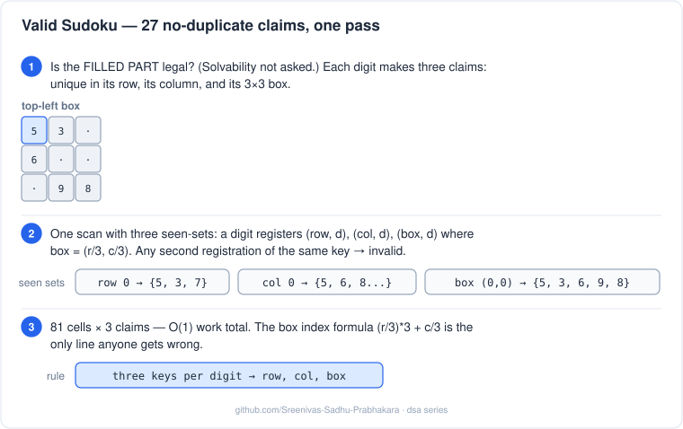

# Valid Sudoku

> NeetCode 150 · Arrays & Hashing — one pass, 27 bitmasks: each digit sets a bit in its row, column and box, and a second setting is the violation. Go, stdlib only, tested.

## Problem

Given a *partially filled* 9×9 board, do the placed digits break any rule (duplicate in a row, column or 3×3 box)? Validity only — the board needn't be solvable, which distinguishes this from the solver (dsa-057, which reuses this exact check as its pre-pass).

## Approach

Twenty-seven uint16 masks — nine rows, nine columns, nine boxes — each a 9-bit set of used digits. Every filled cell does three AND-tests and three OR-sets; a bit already present is a duplicate, immediately false. The box index flattens to `(r/3)*3 + c/3`, the one line worth memorizing. Compared with three map-of-sets, the bitmask version is allocation-free and fits in 54 bytes of state — the same representation that makes the full solver fast. Tests pin the three distinct violation kinds separately, plus the empty board.

**Complexity:** O(81) — constant; O(1) space.

## Visual walkthrough

Read the picture top to bottom — each numbered frame is one moment of the algorithm
running on this repo's test example.

## Run

    go test ./...   # verify
    go run .        # demo

---

Part of a 275-repo DSA series in Go — Striver's SDE Sheet (dsa-001–191) plus the NeetCode 150 / Blind 75 additions (dsa-192–275), stdlib only, every solution tested. Browse: [`dsa-*` repos](https://github.com/Sreenivas-Sadhu-Prabhakara?tab=repositories&q=dsa-&type=source).
